# Relatório de Bugs - Calculadora.py

Relatório dos defeitos encontrados no arquivo `Calculadora.py`.

**Autora:** Catarina Carrilho de Almeida | Ciência de Dados e Inteligência Artificial, SENAI CIMATEC | Data: 04/11/2026

## Resumo

| ID | Título | Severidade | Status |
|---|---|---|---|
| BUG-001 | Calculadora executa sozinha ao importar o módulo | Média | Resolvido |
| BUG-002 | Adição soma o primeiro número duas vezes | Crítica | Não resolvido |
| BUG-003 | Divisão por zero derruba o programa | Alta | Não resolvido |
| BUG-004 | Fatorial retorna sempre zero | Alta | Resolvido |
| BUG-005 | Fatorial aceita número negativo | Média | Não resolvido |
| BUG-006 | Logaritmo natural usa função que não existe | Alta | Não resolvido |
| BUG-007 | Logaritmo base 10 calcula o logaritmo natural | Alta | Não resolvido |
| BUG-008 | Logaritmo base 10 aceita zero | Média | Não resolvido |
| BUG-009 | Funções cosseno e tangente não existem | Alta | Não resolvido |
| BUG-010 | Opção Seno do menu não funciona | Média | Não resolvido |
| BUG-011 | Entrada que não é número encerra o programa | Média | Não resolvido |
| BUG-012 | Potenciação sem tratamento de casos indefinidos | Baixa | Não resolvido |

Os prints, os logs e os testes com pytest foram feitos em Windows, Python 3.14, NumPy 2.5.4 e pytest 9.2.0, no terminal do VS Code com `py Calculadora.py`.

---

## BUG-001: Calculadora executa sozinha ao importar o módulo

**Localização do bug:** Calculadora.py, última linha (`calculadora_cientifica()` fora de `if __name__ == "__main__":`).

**Descrição clara do bug:** A função principal é chamada direto no arquivo, sem a proteção do `__main__`. Por isso, qualquer `import Calculadora` abre o menu e fica esperando o teclado. Isso impede que os testes importem as funções, e o pytest para com erro antes de rodar qualquer teste.

**Contexto:** Windows, Python 3.14, pytest 9.2.0.

**Passo a passo para reproduzir:**

1. Abrir o terminal na pasta do projeto.
2. Executar `py -c "import Calculadora"` e ver o menu aparecer.
3. Criar um teste que importe uma função do módulo e rodar `py -m pytest`.

**Consistência:** Ocorre sempre.

**Resultado esperado:** O import só carrega as funções, sem abrir o menu.

**Resultado obtido:** O menu abre e o programa espera uma entrada. No pytest, a coleta é interrompida com `OSError: pytest: reading from stdin while output is captured`.

**Evidências:** `evidencias/bug-001-import.log` e `evidencias/bug-001-pytest.log`

**Severidade:** Média

**Impacto:** Impede testes automatizados e o reaproveitamento das funções.

**Sugestão de correção:** Colocar a chamada final dentro de `if __name__ == "__main__":`.

**Data de identificação:** 04/11/2026

**Status:** Resolvido. A chamada foi movida para dentro do `if __name__ == "__main__":` antes do TDD, porque os testes dependiam disso. O uso normal com `py Calculadora.py` continua igual.

---

## BUG-002: Adição soma o primeiro número duas vezes

**Localização do bug:** Calculadora.py, função `adicao`.

**Descrição clara do bug:** A função retorna `x + np.add(x, y)`, que dá `2x + y`. A soma, que é a operação mais básica, sai errada para qualquer valor de x diferente de zero.

**Contexto:** Windows, Python 3.14, NumPy 2.5.4.

**Passo a passo para reproduzir:**

1. Executar `py Calculadora.py`.
2. Digitar `1` no menu.
3. Informar `2` como primeiro número.
4. Informar `3` como segundo número.

**Consistência:** Ocorre sempre.

**Resultado esperado:** Resultado: 5.0

**Resultado obtido:** Resultado: 7.0

**Evidências:** `evidencias/bug-002-adicao.log`

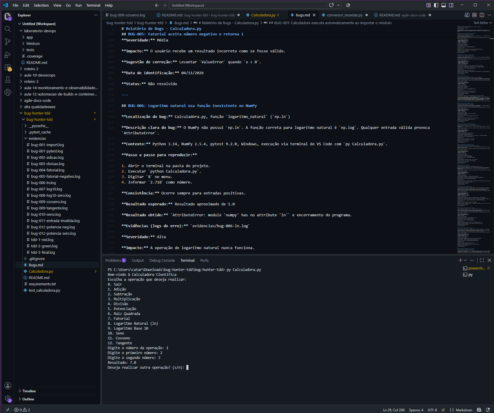

*Figura 1. O resultado exibido é 7.0, quando o esperado era 5.0, o que confirma que a função `adicao` soma o primeiro número duas vezes.*

**Severidade:** Crítica

**Impacto:** Todo cálculo que usa soma fica errado e o programa não avisa nada.

**Sugestão de correção:** Retornar apenas `x + y`.

**Data de identificação:** 04/11/2026

**Status:** Não resolvido

---

## BUG-003: Divisão por zero derruba o programa

**Localização do bug:** Calculadora.py, função `divisao`.

**Descrição clara do bug:** A função faz `x / y` sem checar se `y` é zero. O Python levanta `ZeroDivisionError` e o programa fecha com o erro na tela, em vez de avisar o usuário.

**Contexto:** Windows, Python 3.14.

**Passo a passo para reproduzir:**

1. Executar `py Calculadora.py`.
2. Digitar `4` no menu.
3. Informar `10` como primeiro número.
4. Informar `0` como segundo número.

**Consistência:** Ocorre sempre.

**Resultado esperado:** Mensagem de erro tratada, sem encerrar o programa.

**Resultado obtido:** `ZeroDivisionError: division by zero` e o programa fecha.

**Evidências:** `evidencias/bug-003-divisao.log`

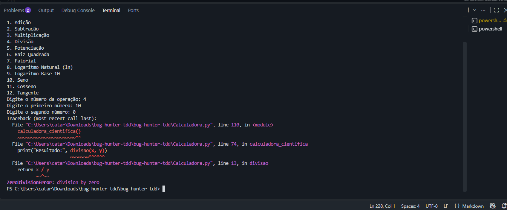

*Figura 2. O programa encerra com `ZeroDivisionError: division by zero` e aponta a linha `return x / y` da função `divisao`, sem nenhuma mensagem tratada para o usuário.*

**Severidade:** Alta

**Impacto:** Uma entrada comum derruba a calculadora inteira.

**Sugestão de correção:** Verificar se `y == 0` antes de dividir e retornar uma mensagem de erro.

**Data de identificação:** 04/11/2026

**Status:** Não resolvido

---

## BUG-004: Fatorial retorna sempre zero

**Localização do bug:** Calculadora.py, função `fatorial` (laço `for i in range(x+1)`).

**Descrição clara do bug:** O laço começa em `i = 0`, porque `range(x+1)` gera de 0 até x. Na primeira volta, `fat *= 0` zera o acumulador e ele continua zero até o fim. O resultado é 0 para qualquer número, até para `fatorial(0)`, que deveria ser 1.

**Contexto:** Windows, Python 3.14, NumPy 2.5.4.

**Passo a passo para reproduzir:**

1. Executar `py Calculadora.py` (na versão original, antes da correção).
2. Digitar `7` no menu.
3. Informar `5` como número.

**Consistência:** Ocorre sempre.

**Resultado esperado:** Resultado: 120

**Resultado obtido:** Resultado: 0

**Evidências:** `evidencias/bug-004-fatorial.log`

**Severidade:** Alta

**Impacto:** A operação de fatorial fica inutilizável.

**Sugestão de correção:** Começar o laço em 1, com `range(1, x+1)`.

**Data de identificação:** 04/11/2026

**Status:** Resolvido

**Correção com TDD:** Este foi o bug escolhido para aplicar a metodologia TDD, seguindo o ciclo Red, Green e Refactor.

1. Red: foi criado o arquivo `test_calculadora.py` com testes para `fatorial` com as entradas 0, 1, 2, 5 e 10. Ao rodar `pytest -v`, os 5 testes falharam, confirmando o bug (`evidencias/tdd-1-red.log`).
2. Green: a correção mínima foi trocar `range(x+1)` por `range(1, x+1)`. Depois disso, os 5 testes passaram (`evidencias/tdd-2-green.log`).
3. Refactor: a variável `fat` foi renomeada para `resultado` e a função ganhou uma docstring, sem mudar o comportamento. Os testes continuaram passando.
4. Verificação final: foram adicionados testes para `subtracao`, `multiplicacao` e `raiz_quadrada`, que não foram alteradas, para garantir que a correção não criou bugs novos. Também foi adicionado um teste marcado como `xfail` para o BUG-005, que ainda não foi corrigido. O resultado final foi 9 testes passando e 1 `xfailed` (`evidencias/tdd-3-final.log`).

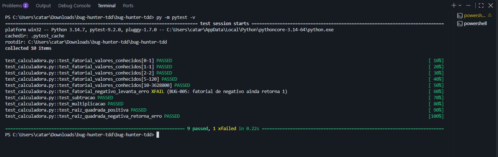

*Figura 3. Saída do pytest após a correção: 9 testes passando e 1 `xfailed`.*

A correção resolve o bug porque o acumulador deixa de ser multiplicado por zero, e `fatorial(0)` passa a retornar 1, como manda a definição matemática.

---

## BUG-005: Fatorial aceita número negativo

**Localização do bug:** Calculadora.py, função `fatorial`.

**Descrição clara do bug:** A função não valida o argumento. Com número negativo, o laço não roda e a função devolve 1, mas o fatorial não existe para negativos.

**Contexto:** Windows, Python 3.14.

**Passo a passo para reproduzir:**

1. Executar `py Calculadora.py`.
2. Digitar `7` no menu.
3. Informar `-3` como número.

**Consistência:** Ocorre sempre.

**Resultado esperado:** Mensagem de erro ou exceção `ValueError`.

**Resultado obtido:** Resultado: 1

**Evidências:** `evidencias/bug-005-fatorial-negativo.log`

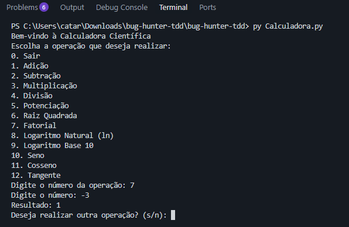

*Figura 4. O fatorial de -3 retorna 1, mas o fatorial não existe para números negativos, então a entrada deveria ser recusada.*

**Severidade:** Média

**Impacto:** O usuário recebe um resultado inválido como se estivesse certo.

**Sugestão de correção:** Levantar `ValueError` quando `x < 0`.

**Data de identificação:** 04/11/2026

**Status:** Não resolvido (registrado como `xfail` em `test_calculadora.py`)

---

## BUG-006: Logaritmo natural usa função que não existe

**Localização do bug:** Calculadora.py, função `logaritmo_natural` (`np.ln`).

**Descrição clara do bug:** O NumPy não tem `np.ln`. A função certa para o logaritmo natural é `np.log`. Qualquer número positivo gera `AttributeError`.

**Contexto:** Windows, Python 3.14, NumPy 2.5.4.

**Passo a passo para reproduzir:**

1. Executar `py Calculadora.py`.
2. Digitar `8` no menu.
3. Informar `2.718` como número.

**Consistência:** Ocorre sempre para números positivos.

**Resultado esperado:** Resultado próximo de 1.0

**Resultado obtido:** `AttributeError: module 'numpy' has no attribute 'ln'` e o programa fecha.

**Evidências:** `evidencias/bug-006-ln.log`

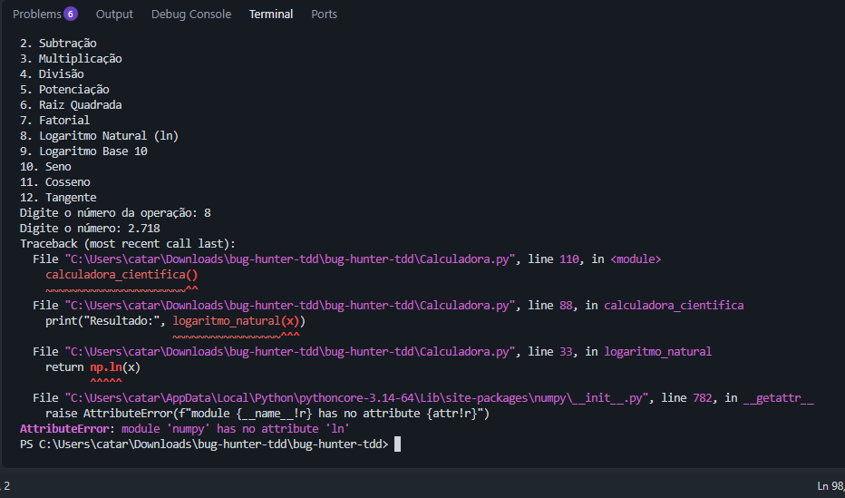

*Figura 5. O traceback termina em `AttributeError: module 'numpy' has no attribute 'ln'` e mostra a linha `np.ln(x)` da função `logaritmo_natural`.*

**Severidade:** Alta

**Impacto:** A operação de logaritmo natural nunca funciona.

**Sugestão de correção:** Trocar `np.ln(x)` por `np.log(x)`.

**Data de identificação:** 04/11/2026

**Status:** Não resolvido

---

## BUG-007: Logaritmo base 10 calcula o logaritmo natural

**Localização do bug:** Calculadora.py, função `logaritmo_base10` (`np.log`).

**Descrição clara do bug:** A função usa `np.log`, que é o logaritmo natural. Para a base 10 o certo é `np.log10`. Não dá erro, mas o valor sai errado.

**Contexto:** Windows, Python 3.14, NumPy 2.5.4.

**Passo a passo para reproduzir:**

1. Executar `py Calculadora.py`.
2. Digitar `9` no menu.
3. Informar `100` como número.

**Consistência:** Ocorre sempre.

**Resultado esperado:** Resultado: 2.0

**Resultado obtido:** Resultado: 4.605170185988092

**Evidências:** `evidencias/bug-007-log10.log`

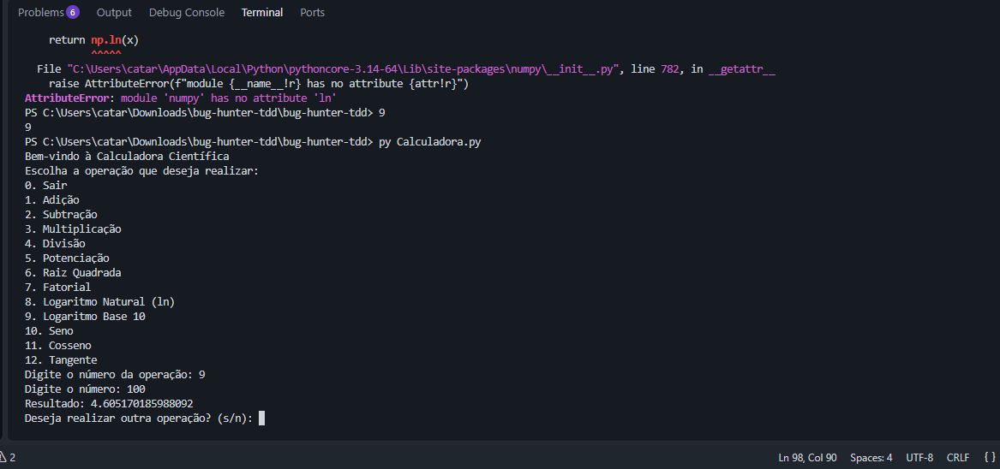

*Figura 6. O resultado 4.605170185988092 é o logaritmo natural de 100, e não 2.0, valor esperado para a base 10.*

**Severidade:** Alta

**Impacto:** O resultado é errado e difícil de perceber, porque o programa não mostra erro.

**Sugestão de correção:** Trocar `np.log(x)` por `np.log10(x)`.

**Data de identificação:** 04/11/2026

**Status:** Não resolvido

---

## BUG-008: Logaritmo base 10 aceita zero

**Localização do bug:** Calculadora.py, função `logaritmo_base10` (condição `x < 0`).

**Descrição clara do bug:** A validação usa `x < 0`, mas o logaritmo também não existe para zero. A própria mensagem de erro fala em "número não positivo", e o `logaritmo_natural` já usa `x <= 0`. Com `x = 0`, o programa mostra `-inf` e um aviso do NumPy.

**Contexto:** Windows, Python 3.14, NumPy 2.5.4.

**Passo a passo para reproduzir:**

1. Executar `py Calculadora.py`.
2. Digitar `9` no menu.
3. Informar `0` como número.

**Consistência:** Ocorre sempre.

**Resultado esperado:** Mensagem "Erro: Logaritmo de número não positivo".

**Resultado obtido:** `RuntimeWarning: divide by zero encountered in log` e Resultado: -inf

**Evidências:** `evidencias/bug-008-log10-zero.log`

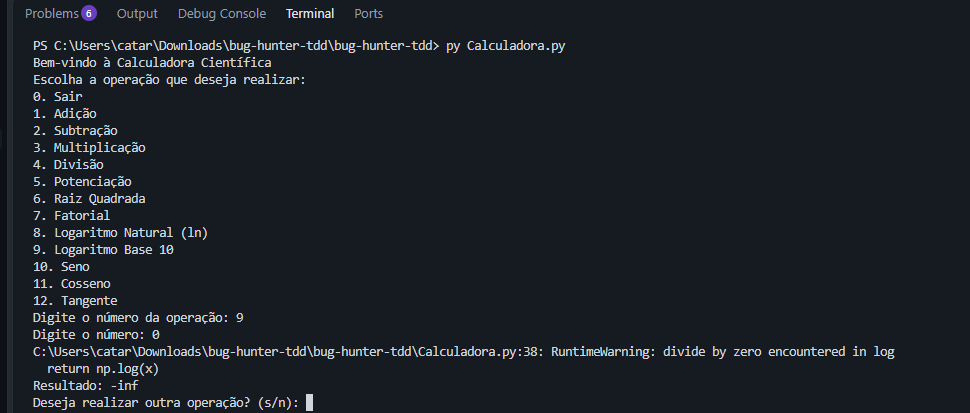

*Figura 7. O NumPy emite um aviso e o programa mostra `Resultado: -inf`, quando deveria exibir a mensagem de erro para número não positivo.*

**Severidade:** Média

**Impacto:** Um valor inválido aparece como resultado, e a validação fica diferente da outra função de logaritmo.

**Sugestão de correção:** Trocar a condição para `x <= 0`.

**Data de identificação:** 04/11/2026

**Status:** Não resolvido

---

## BUG-009: Funções cosseno e tangente não existem

**Localização do bug:** Calculadora.py, função `calculadora_cientifica` (opções 11 e 12 chamam `cosseno` e `tangente`).

**Descrição clara do bug:** O menu oferece cosseno e tangente e o fluxo chama as duas funções, mas elas nunca foram definidas no arquivo. A chamada da tangente ainda usa um parâmetro `radianos=False` que também não existe em lugar nenhum.

**Contexto:** Windows, Python 3.14.

**Passo a passo para reproduzir:**

1. Executar `py Calculadora.py`.
2. Digitar `11` no menu.
3. Informar `60` como ângulo em graus.
4. Repetir com a opção `12` e o ângulo `45`.

**Consistência:** Ocorre sempre.

**Resultado esperado:** Cosseno de 60° próximo de 0.5 e tangente de 45° próxima de 1.0.

**Resultado obtido:** `NameError: name 'cosseno' is not defined` e `NameError: name 'tangente' is not defined`.

**Evidências:** `evidencias/bug-009-cosseno.log` e `evidencias/bug-009-tangente.log`

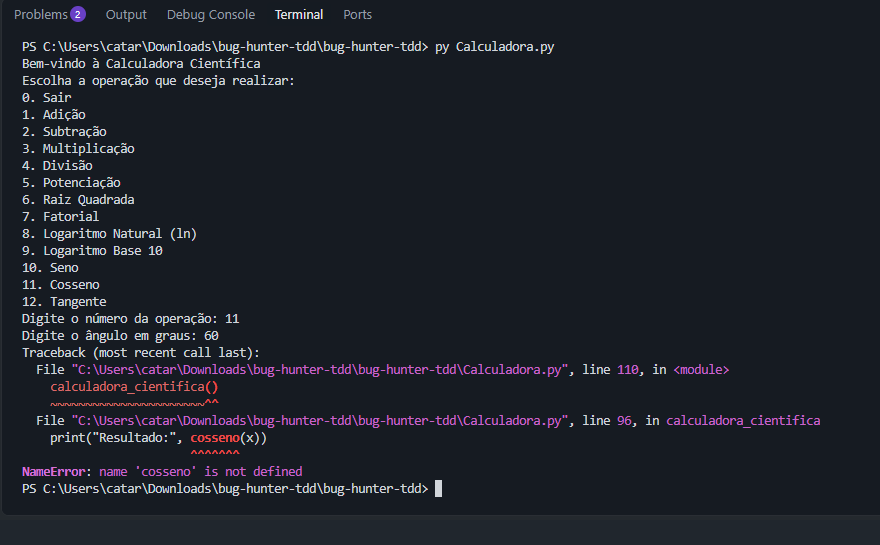

*Figura 8. O programa encerra com `NameError: name 'cosseno' is not defined`, porque a função nunca foi criada. A opção 12 (Tangente) falha da mesma forma, como mostra o log desse bug.*

**Severidade:** Alta

**Impacto:** Duas operações do menu derrubam o programa.

**Sugestão de correção:** Criar `cosseno(x)` e `tangente(x, radianos=True)` usando `np.cos`, `np.tan` e `np.radians`.

**Data de identificação:** 04/11/2026

**Status:** Não resolvido

---

## BUG-010: Opção Seno do menu não funciona

**Localização do bug:** Calculadora.py, funções `menu` e `calculadora_cientifica` (opção 10).

**Descrição clara do bug:** O menu mostra a opção 10 (Seno), mas não existe a função `seno` nem um `elif escolha == '10'` no fluxo. A escolha cai no `else` e o programa responde "Operação inválida" para uma opção que aparece no menu.

**Contexto:** Windows, Python 3.14.

**Passo a passo para reproduzir:**

1. Executar `py Calculadora.py`.
2. Digitar `10` no menu.

**Consistência:** Ocorre sempre.

**Resultado esperado:** O programa pedir o ângulo em graus e mostrar o seno.

**Resultado obtido:** "Operação inválida. Tente novamente."

**Evidências:** `evidencias/bug-010-seno.log`

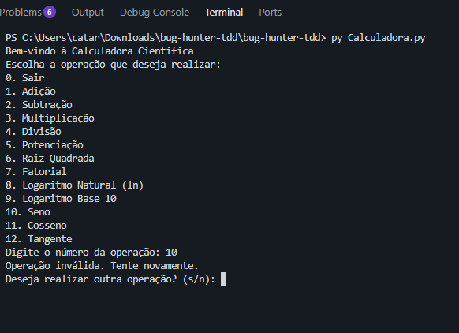

*Figura 9. Mesmo aparecendo no menu, a escolha cai no `else` e o programa responde `Operação inválida. Tente novamente.`*

**Severidade:** Média

**Impacto:** Uma função que aparece no menu não pode ser usada, e a mensagem confunde o usuário.

**Sugestão de correção:** Criar `seno(x)` e adicionar a opção 10 no fluxo principal.

**Data de identificação:** 04/11/2026

**Status:** Não resolvido

---

## BUG-011: Entrada que não é número encerra o programa

**Localização do bug:** Calculadora.py, função `calculadora_cientifica` (conversões com `float(input(...))` e `int(input(...))`).

**Descrição clara do bug:** As conversões da entrada não têm tratamento de erro. Se o usuário digitar texto no lugar de número, o programa fecha com `ValueError`. No fatorial, que usa `int`, um número decimal como `3.5` gera o mesmo erro.

**Contexto:** Windows, Python 3.14.

**Passo a passo para reproduzir:**

1. Executar `py Calculadora.py`.
2. Digitar `1` no menu.
3. Informar `abc` como primeiro número.

**Consistência:** Ocorre sempre.

**Resultado esperado:** Mensagem pedindo um número válido, sem fechar o programa.

**Resultado obtido:** `ValueError: could not convert string to float: 'abc'`.

**Evidências:** `evidencias/bug-011-entrada-invalida.log`

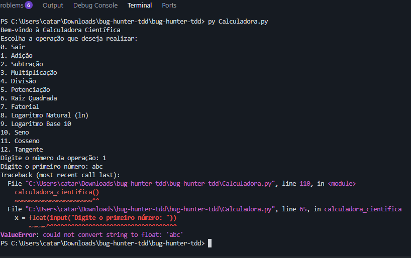

*Figura 10. O programa encerra com `ValueError: could not convert string to float: 'abc'` ao receber texto no lugar de número.*

**Severidade:** Média

**Impacto:** Um erro comum de digitação derruba a calculadora.

**Sugestão de correção:** Usar `try/except ValueError` nas conversões.

**Data de identificação:** 04/11/2026

**Status:** Não resolvido

---

## BUG-012: Potenciação sem tratamento de casos indefinidos

**Localização do bug:** Calculadora.py, função `potencia`.

**Descrição clara do bug:** Casos como `0 ** -1` e base negativa com expoente fracionário, como `(-8) ** 0.5`, não são validados. O NumPy gera `RuntimeWarning` e o programa mostra `inf` ou `nan` como se fossem resultados normais. Já a raiz quadrada trata o caso negativo.

**Contexto:** Windows, Python 3.14, NumPy 2.5.4.

**Passo a passo para reproduzir:**

1. Executar `py Calculadora.py`.
2. Digitar `5` no menu.
3. Informar `0` como primeiro número e `-1` como segundo.
4. Repetir com `-8` e `0.5`.

**Consistência:** Ocorre sempre.

**Resultado esperado:** Mensagem de erro para operação indefinida.

**Resultado obtido:** `RuntimeWarning` e Resultado: inf (primeiro caso) e Resultado: nan (segundo caso).

**Evidências:** `evidencias/bug-012-potencia-zero.log` e `evidencias/bug-012-potencia-neg.log`

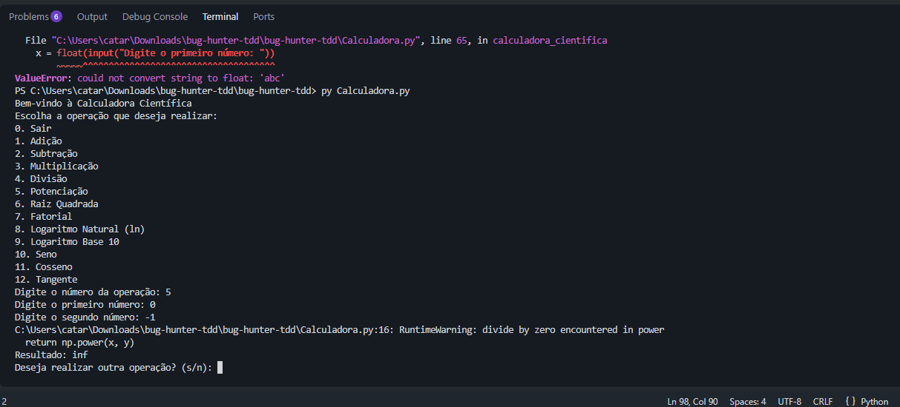

*Figura 11. A potenciação de 0 por -1 mostra `inf` e emite um aviso do NumPy, sem mensagem de erro. O caso de -8 por 0,5, que resulta em `nan`, está no log `bug-012-potencia-neg.log`.*

**Severidade:** Baixa

**Impacto:** Valores especiais do ponto flutuante aparecem sem explicação.

**Sugestão de correção:** Validar esses casos antes de chamar `np.power`.

**Data de identificação:** 04/11/2026

**Status:** Não resolvido
